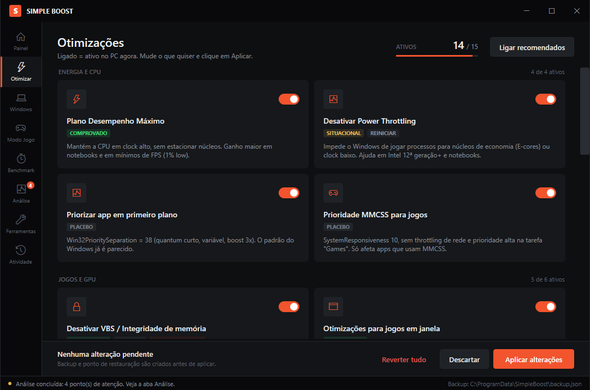
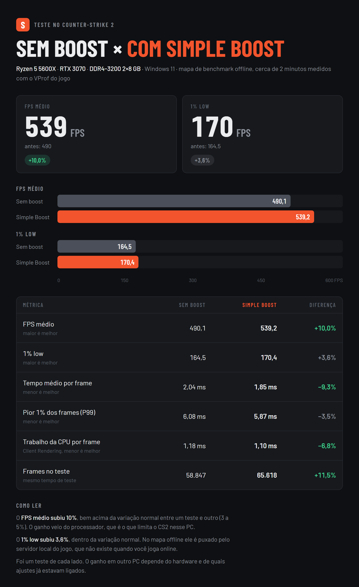
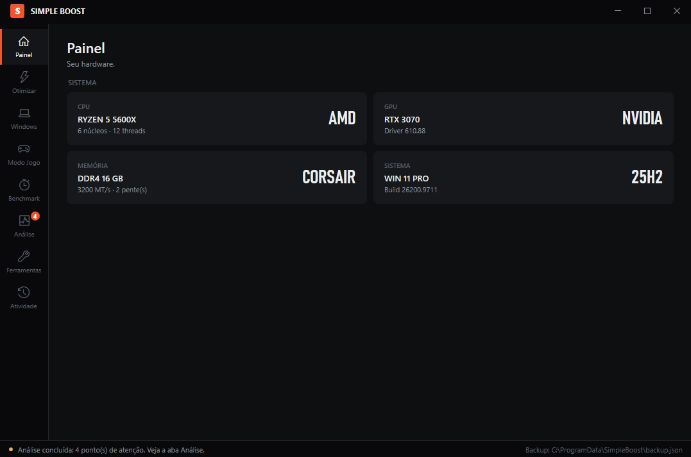
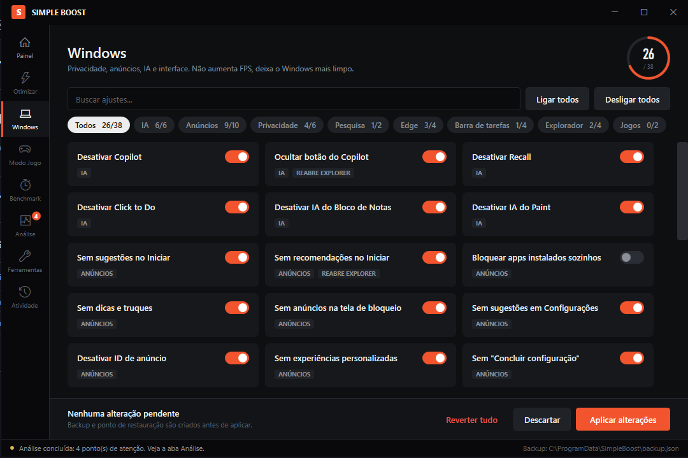
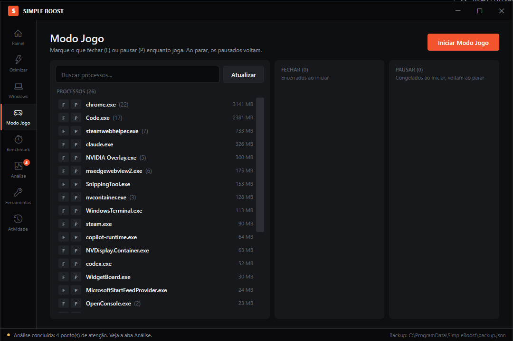
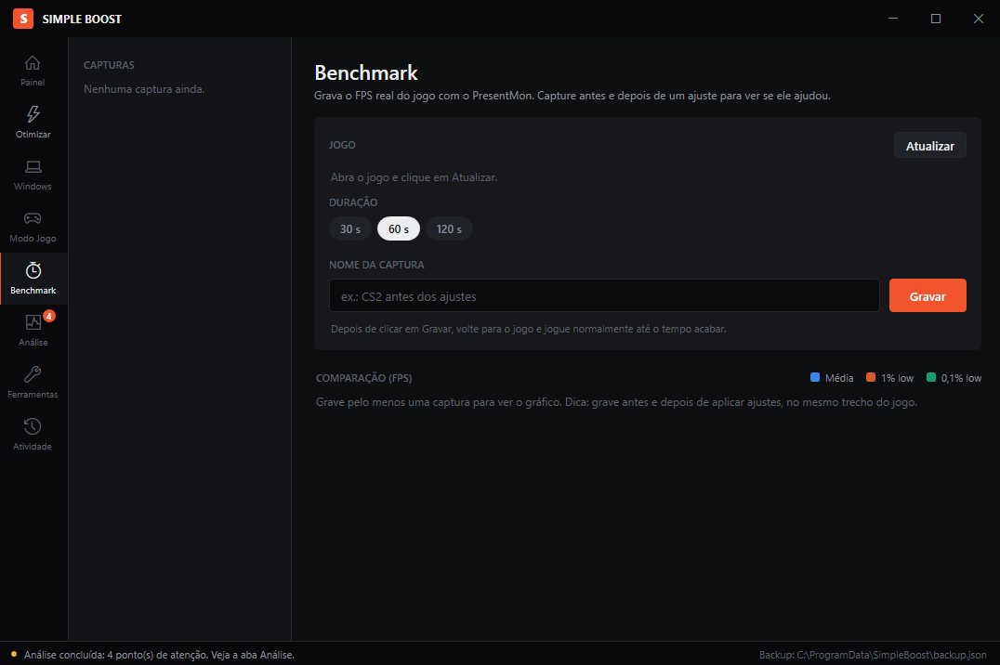
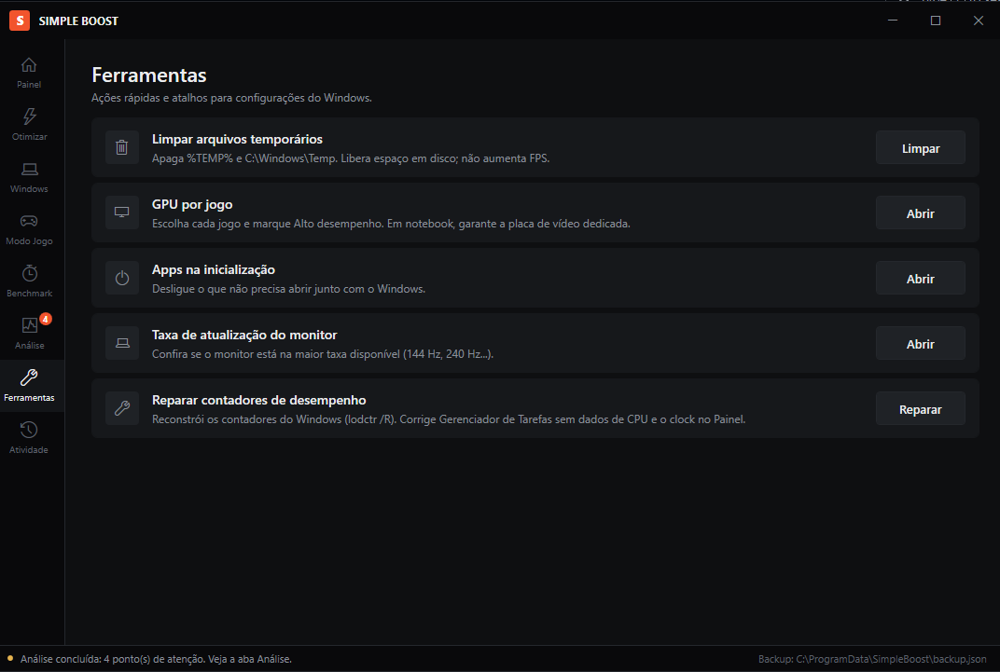

# Simple Boost

Otimizador para jogos no Windows 10/11 (64 bits). Junta num lugar só os ajustes que realmente fazem diferença, mostra o que cada um faz e permite desfazer qualquer um com um clique.



## Download

1. Vá em **[Releases](../../releases/latest)** e baixe o `SimpleBoost.exe`.
2. Dê dois cliques. O Windows vai pedir permissão de administrador. Pode aceitar, o programa precisa disso para mudar as configurações do sistema.

Não precisa instalar nada.

### "O Windows protegeu o computador"

O executável não tem assinatura digital paga, então o SmartScreen pode avisar na primeira vez. Clique em **Mais informações → Executar assim mesmo**.

Alguns antivírus também podem desconfiar, porque o programa mexe no registro e no plano de energia. O código-fonte inteiro está aqui no repositório (`SimpleBoost.ps1`) para quem quiser conferir. O `.exe` das Releases é compilado pelo próprio GitHub a partir desse código (veja a aba **Actions**), não no PC de ninguém.

## Resultado no CS2

Teste num Ryzen 5 5600X com RTX 3070: **+10% de FPS médio**. O ganho em outro PC depende do hardware e de quais ajustes já estavam ligados.



## O que ele faz

### Painel
Mostra seu processador, placa de vídeo, memória e versão do Windows.



### Otimizar
Os ajustes que mexem no desempenho: plano de energia, Game DVR, Modo de Jogo, VBS, HAGS, rede e outros. Cada um diz se o ganho é **comprovado**, **situacional** ou **placebo**, e se precisa reiniciar. O botão **Ligar recomendados** marca só os que valem a pena.

### Windows
Deixa o Windows mais limpo: desliga Copilot, Recall, anúncios, sugestões e rastreamento. Não aumenta FPS, mas tira coisa rodando à toa.



### Modo Jogo
Você marca o que **fechar** (F) ou **pausar** (P) enquanto joga. Ao parar o Modo Jogo, os programas pausados voltam do ponto onde estavam.



### Benchmark
Grava o FPS real do jogo com o PresentMon. Capture antes e depois de um ajuste para ver se ele ajudou de verdade.



### Análise
Procura problemas comuns: monitor abaixo da taxa máxima, RAM em single channel, notebook na bateria, VBS ligado etc.

### Ferramentas e Atividade
Atalhos úteis (limpar temporários, GPU por jogo, apps na inicialização, taxa do monitor, reparar contadores) e o registro de tudo que o programa fez.



## Dá para desfazer?

Sim. Antes de mudar qualquer coisa, o Simple Boost guarda o valor original em `C:\ProgramData\SimpleBoost\backup.json`. Você pode reverter cada ajuste separadamente ou todos de uma vez pelo botão **Reverter tudo**.

Mesmo assim, vale criar um ponto de restauração do Windows antes de usar pela primeira vez.

## Funciona junto com o Process Lasso?

Sim. Só tem um ponto que se sobrepõe: **o plano de energia**. Os dois programas trocam o plano de energia, e o último a trocar é o que fica valendo. Escolha um:

- **Usar o do Simple Boost:** no Process Lasso, desligue a troca automática de plano (*Power → Performance Mode* e a opção de trocar o plano ao abrir jogos).
- **Usar o do Process Lasso:** deixe o ajuste **Plano Desempenho Máximo** desmarcado no Simple Boost.

O resto (ProBalance, afinidade e prioridade por processo) não conflita com nenhum ajuste do Simple Boost. O Modo Jogo nunca pausa nem fecha o Process Lasso.

## Para quem quer compilar

```powershell
powershell -ExecutionPolicy Bypass -File build.ps1
```

Gera `dist\SimpleBoost.exe` usando o compilador C# que já vem com o Windows. O `.exe` só embute o `SimpleBoost.ps1` e o ícone, e abre a interface sem janela de console.

Para rodar direto do script, sem compilar, use o `Iniciar.bat`.

## Licença

[MIT](LICENSE).
